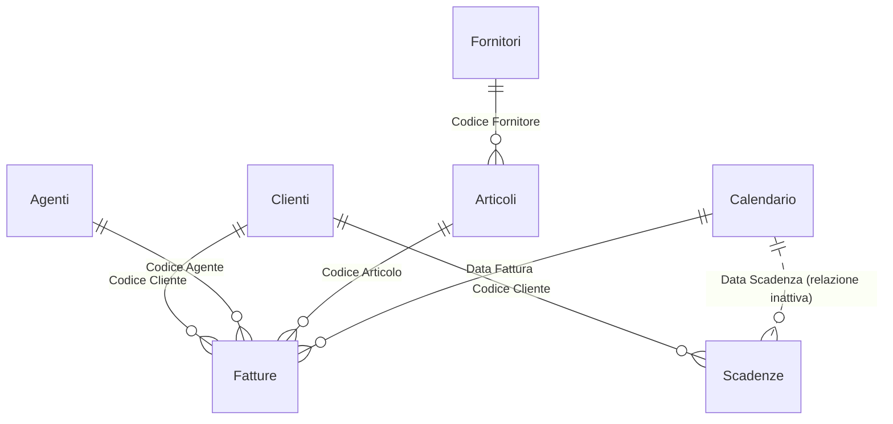

# Analisi vendite e crediti – Power BI

Report per la direzione commerciale e amministrativa di un'azienda di distribuzione: andamento del fatturato, performance di agenti e zone, concentrazione dei clienti (ABC) e rischio di credito (scaduto e DSO).

> I dati sono **inventati** e generati con Python. Il progetto ricostruisce in forma generica tecniche usate in progetti reali: non contiene dati, nomi o codice di clienti.

## Domande a cui risponde

- Quanto stiamo fatturando da inizio anno rispetto allo stesso periodo dell'anno scorso?
- Quali agenti, zone e canali crescono e quali calano?
- Quali clienti fanno l'80% del fatturato (classe A)? Quanti clienti nuovi e persi?
- Quanto pesano sconti e omaggi sul valore a listino?
- Quanto credito è scaduto e in quanti giorni incassiamo in media (DSO)?

## Modello dati

Schema a stella con un calendario dedicato e una tabella di sole misure (`_Misure`).



## Misure DAX principali

Tutte le 30 misure sono in [`dax/misure.dax`](dax/misure.dax), organizzate in cartelle e con descrizione.

**Periodo dinamico con confronto anno precedente.** Se l'utente non filtra date, il report mostra l'anno in corso fino all'ultima data disponibile. Se filtra un periodo, il confronto con l'anno precedente viene troncato alla stessa data, così un anno in corso non viene confrontato con un anno intero.

```dax
Fatturato Periodo AP =
VAR FiltroData =
    ISFILTERED ( Calendario[Data] ) || ISFILTERED ( Calendario[Anno] ) || ISFILTERED ( Calendario[Mese] )
        || ISFILTERED ( Calendario[Anno Mese] ) || ISFILTERED ( Calendario[Trimestre] )
VAR Rif = [Data Riferimento]
VAR Inizio = IF ( FiltroData, MIN ( Calendario[Data] ), DATE ( YEAR ( Rif ), 1, 1 ) )
VAR Fine = IF ( FiltroData, MIN ( MAX ( Calendario[Data] ), Rif ), Rif )
RETURN
    CALCULATE ( [Fatturato], DATESBETWEEN ( Calendario[Data], EDATE ( Inizio, -12 ), EDATE ( Fine, -12 ) ) )
```

**Classificazione ABC dinamica.** La quota cumulata si ricalcola sui clienti visibili con i filtri attivi (zona, canale, periodo).

```dax
Quota Cumulata Cliente % =
VAR Elenco = FILTER ( ALLSELECTED ( Clienti[Ragione Sociale] ), NOT ISBLANK ( [Fatturato Periodo] ) )
VAR Valore = [Fatturato Periodo]
VAR Cumulato = SUMX ( FILTER ( Elenco, [Fatturato Periodo] >= Valore ), [Fatturato Periodo] )
RETURN IF ( NOT ISBLANK ( Valore ), DIVIDE ( Cumulato, SUMX ( Elenco, [Fatturato Periodo] ) ) )
```

**DSO.** Il credito aperto viene espresso in giorni di fatturato. La finestra di calcolo (90, 180 o 365 giorni) si sceglie con uno slicer collegato a una tabella parametro.

```dax
DSO (giorni) = DIVIDE ( [Credito Aperto], [Fatturato Medio Giornaliero] )
```

Altre tecniche: `USERELATIONSHIP` su relazione inattiva, `RANKX` con `ISINSCOPE`, clienti nuovi e persi con tabelle virtuali (`ADDCOLUMNS` + `FILTER`), parametro what-if con `SELECTEDVALUE`.

## Pagine del report

| Pagina | Contenuto |
|---|---|
| Panoramica | KPI dell'anno, fatturato mensile vs anno precedente, fatturato per famiglia |
| Agenti e zone | Matrice agenti con quota sul totale, fatturato per zona e canale |
| Clienti e ABC | Classifica clienti con quota cumulata e classe ABC, clienti nuovi e persi |
| Articoli e fornitori | Matrice famiglia > articolo, fatturato per fornitore |
| Crediti e DSO | Credito aperto e scaduto, DSO, ritardo medio degli incassi per cliente |

<!-- Aggiungi qui gli screenshot, ad esempio:  -->

## SQL

La cartella [`sql`](sql) contiene le viste che, da un gestionale, produrrebbero le tabelle del modello (fatture e note di credito con segno, omaggi, rate incassate), più le stesse analisi scritte in SQL: confronto anno precedente con `LAG`, progressivo con `SUM() OVER`, ABC con somme cumulate e aging dello scaduto.

## Struttura

```
01-powerbi-vendite-crediti/
├── AnalisiVenditeCrediti.pbip           ← file da aprire con Power BI Desktop
├── AnalisiVenditeCrediti.SemanticModel/ ← modello in formato TMDL (tabelle, relazioni, misure)
├── AnalisiVenditeCrediti.Report/        ← pagine e visual in formato PBIR
├── dax/misure.dax                       ← tutte le misure in un unico file leggibile
├── sql/                                 ← viste e query di analisi
└── data/                                ← dati di esempio in CSV
```

## Come aprirlo

1. Scarica il repository e apri `AnalisiVenditeCrediti.pbip` con Power BI Desktop (versione recente).
2. In **Trasforma dati → Modifica parametri** imposta `CartellaDati` sul percorso della cartella `data` di questo progetto, con la barra finale (es. `C:\progetti\data-portfolio\01-powerbi-vendite-crediti\data\`).
3. Clicca **Aggiorna**.
