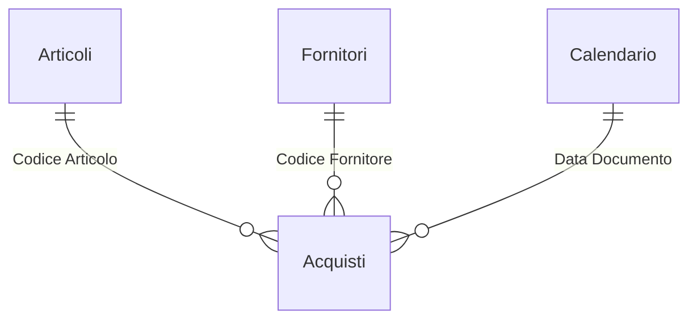

# Analisi acquisti e classificazione ABC – Power BI

Report per l'ufficio acquisti: quanto si spende e con chi, quali articoli concentrano la spesa (ABC), come cambiano i prezzi di carico rispetto all'anno precedente e dove il costo pagato supera il listino del fornitore.

> I dati sono **inventati** e generati con Python. Il progetto ricostruisce in forma generica tecniche usate in progetti reali: non contiene dati, nomi o codice di clienti.

## Domande a cui risponde

- Quanto abbiamo speso da inizio anno e quanto è cambiato rispetto all'anno scorso?
- I prezzi d'acquisto stanno salendo? Di quanto, per articolo e per fornitore?
- Quali articoli, famiglie e fornitori fanno l'80% della spesa?
- Dove paghiamo più del listino, o mancano i listini di riferimento?

## Modello dati



## Misure DAX principali

Tutte le 27 misure sono in [`dax/misure.dax`](dax/misure.dax).

**Inflazione dei prezzi di carico.** Il prezzo medio unitario da inizio anno viene confrontato con lo stesso periodo dell'anno precedente.

```dax
Var % Prezzo Medio = DIVIDE ( [Prezzo Medio YTD] - [Prezzo Medio YTD AP], [Prezzo Medio YTD AP] )
```

**ABC su tre livelli.** Lo stesso schema di calcolo si applica ad articoli, famiglie e fornitori.

```dax
Classe ABC Articolo =
VAR Quota = [Quota Cumulata Articolo %]
RETURN SWITCH ( TRUE (), ISBLANK ( Quota ), BLANK (), Quota <= 0.80, "A", Quota <= 0.95, "B", "C" )
```

**Conteggio documenti con regole diverse.** I carichi da fornitore si contano per numero di documento. I carichi interni, che non hanno un numero, si contano per combinazione unica di data e fornitore (`SUMMARIZE` su una tabella filtrata).

**Controlli di qualità del dato.** Una misura testuale segnala "Listino mancante" o "Costo sopra listino", da usare come filtro operativo.

## Pagine del report

| Pagina | Contenuto |
|---|---|
| Sintesi | KPI di spesa, inflazione e risparmio vs listino, andamento mensile, spesa per famiglia |
| Analisi ABC | Articoli e famiglie ordinati per spesa con quota cumulata e classe |
| Fornitori e prezzi | Fornitori con variazione di spesa e di prezzo, articoli con controllo listino |

<!-- Aggiungi qui gli screenshot, ad esempio:  -->

## SQL

In [`sql`](sql): la vista dei carichi, che recupera il listino valido alla data del movimento (`ROW_NUMBER` sui periodi di validità) e gestisce i resi con il segno. Ci sono anche una query di controllo sugli articoli senza listino e il confronto del prezzo medio anno su anno con `LAG`.

## Come aprirlo

1. Apri `AnalisiAcquisti.pbip` con Power BI Desktop.
2. In **Trasforma dati → Modifica parametri** imposta `CartellaDati` sul percorso della cartella `data` di questo progetto, con la barra finale.
3. Clicca **Aggiorna**.
