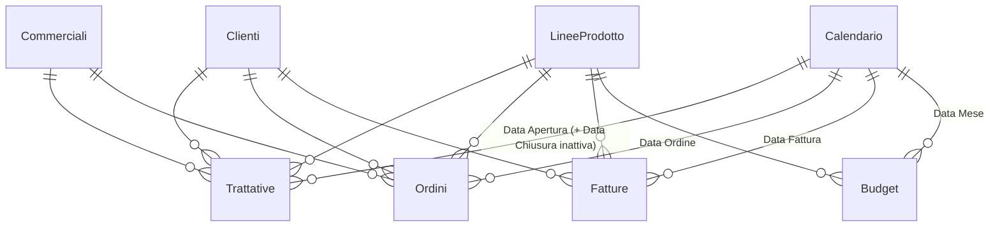

# Pipeline commerciale: offerte, ordini, fatturato e budget – Power BI

Report per la direzione vendite di un'azienda di software e servizi. Segue l'intero ciclo commerciale: trattative aperte, vinte e perse, ordini, fatturato, backlog da fatturare e confronto con il budget. Distingue i ricavi one-off da quelli ricorrenti (canoni).

> I dati sono **inventati** e generati con Python. Il progetto ricostruisce in forma generica tecniche usate in progetti reali: non contiene dati, nomi o codice di clienti.

## Domande a cui risponde

- Quante trattative apriamo, quante ne vinciamo (win rate) e quanto tempo serve per chiuderle?
- Perché perdiamo le trattative?
- Quanto ordinato resta da fatturare (backlog), separato tra one-off e canoni ricorrenti?
- Siamo in linea con il budget? Dove arriveremo a fine anno (forecast)?
- Quanti clienti nuovi acquisiamo e quanti ne perdiamo?

## Modello dati

Quattro tabelle dei fatti (trattative, ordini, fatture, budget) condividono le stesse dimensioni. La data di chiusura delle trattative usa una relazione inattiva, attivata nelle misure con `USERELATIONSHIP`.



## Misure DAX principali

Tutte le 34 misure sono in [`dax/misure.dax`](dax/misure.dax).

**Win rate per data di chiusura**, con una relazione inattiva.

```dax
Valore Vinto =
CALCULATE ( SUM ( Trattative[Valore] ), Trattative[Stato] = "Vinta", USERELATIONSHIP ( Trattative[Data Chiusura], Calendario[Data] ) )
```

**Backlog a una data**: ordini cumulati meno fatture cumulate, calcolato alla fine del periodo selezionato. In un grafico mensile mostra quindi l'evoluzione del backlog.

```dax
Backlog =
VAR Fine = MIN ( MAX ( Calendario[Data] ), [Data Riferimento] )
VAR OrdinatoCumulato = CALCULATE ( [Ordinato], REMOVEFILTERS ( Calendario ), Calendario[Data] <= Fine )
VAR FatturatoCumulato = CALCULATE ( [Fatturato], REMOVEFILTERS ( Calendario ), Calendario[Data] <= Fine )
RETURN OrdinatoCumulato - FatturatoCumulato
```

**Selettore di misura.** Una tabella disconnessa e un `SWITCH` permettono all'utente di scegliere se vedere offerto, ordinato o fatturato nello stesso grafico.

Altre tecniche: forecast a fine anno, clienti nuovi e persi con tabelle virtuali, budget mensile collegato al calendario.

## Pagine del report

| Pagina | Contenuto |
|---|---|
| Pipeline | Trattative, pipeline aperta, win rate, durata media, motivi di perdita, tabella commerciali |
| Ordinato e fatturato | Selettore di misura, backlog one-off e ricorrente, matrice linea × anno |
| Budget e forecast | Fatturato YTD vs budget e vs anno precedente, forecast a fine anno per linea |
| Clienti | Clienti fatturati, nuovi e persi, top clienti con backlog e pipeline |

<!-- Aggiungi qui gli screenshot, ad esempio:  -->

## SQL

In [`sql`](sql): normalizzazione degli stati del CRM e vista del backlog per ordine. Ci sono anche il win rate trimestrale per commerciale con confronto con il team e media mobile (`AVG() OVER ... ROWS BETWEEN 3 PRECEDING`), e l'imbuto trattativa → ordine → fattura.

## Come aprirlo

1. Apri `PipelineCommerciale.pbip` con Power BI Desktop.
2. In **Trasforma dati → Modifica parametri** imposta `CartellaDati` sul percorso della cartella `data` di questo progetto, con la barra finale.
3. Clicca **Aggiorna**.
