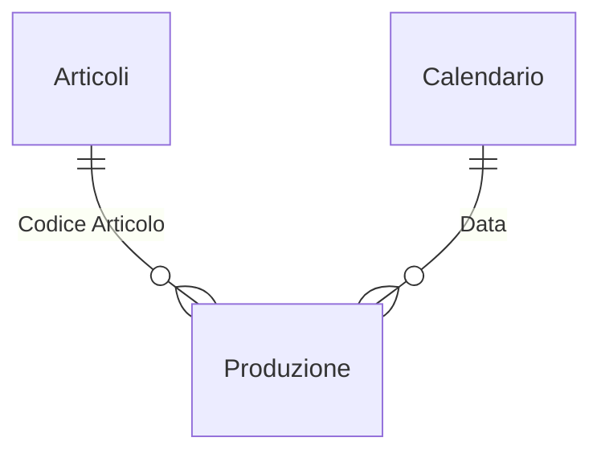

# Reparto produzione: scarti e produttività – Power BI

Report per il responsabile di produzione di un reparto di estrusione film: resa della materia prima, percentuale di scarto rispetto a un obiettivo e produttività di linee e turni.

> I dati sono **inventati** e generati con Python. Il progetto ricostruisce in forma generica tecniche usate in progetti reali: non contiene dati, nomi o codice di clienti.

## Domande a cui risponde

- Quanta materia prima diventa prodotto vendibile (resa) e quanta va persa (scarto, rifili)?
- Lo scarto sta migliorando rispetto all'anno scorso?
- Quali linee e turni sono fuori target, e quanti chili di scarto in più producono?
- Quanti kg/h e m²/h produce ogni linea?

## Modello dati



La tabella `Target Scarto` è un parametro disconnesso: l'utente sceglie l'obiettivo (dal 3% al 5%) e le misure si ricalcolano.

## Misure DAX principali

Tutte le 26 misure sono in [`dax/misure.dax`](dax/misure.dax).

**Scarto oltre il target, linea per linea.** Il calcolo avviene su ogni linea, così una linea molto sotto target non nasconde una linea fuori target.

```dax
Scarto Oltre Target Kg =
SUMX ( VALUES ( Produzione[Linea] ), MAX ( 0, [Scarto Kg] - [Consumo Kg] * [Target Scarto %] ) )
```

**Delta in punti percentuali** rispetto allo stesso periodo dell'anno precedente, con formato `+0.00%;-0.00%`.

**Semaforo testuale** ("Entro target", "Attenzione", "Fuori target") da usare in tabelle e formattazione condizionale.

## Pagine del report

| Pagina | Contenuto |
|---|---|
| Reparto | KPI di resa, scarto e produttività; produzione e % scarto per mese; produttività per linea |
| Linee e turni | Matrice linea × turno, confronto con il target e con l'anno precedente, scarto per famiglia |
| Dettaglio ordini | Elenco degli ordini di produzione con KPI e stato rispetto al target |

<!-- Aggiungi qui gli screenshot, ad esempio:  -->

## SQL

In [`sql`](sql): la vista che trasforma le dichiarazioni di produzione in una riga per ordine e turno (pivot con `SUM(CASE ...)`). C'è anche lo scarto settimanale con media mobile su 4 settimane e classifica delle linee con `RANK() OVER`.

## Come aprirlo

1. Apri `AnalisiProduzione.pbip` con Power BI Desktop.
2. In **Trasforma dati → Modifica parametri** imposta `CartellaDati` sul percorso della cartella `data` di questo progetto, con la barra finale.
3. Clicca **Aggiorna**.
