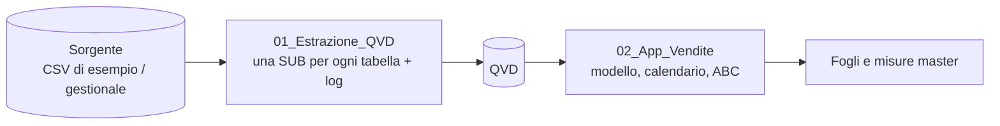
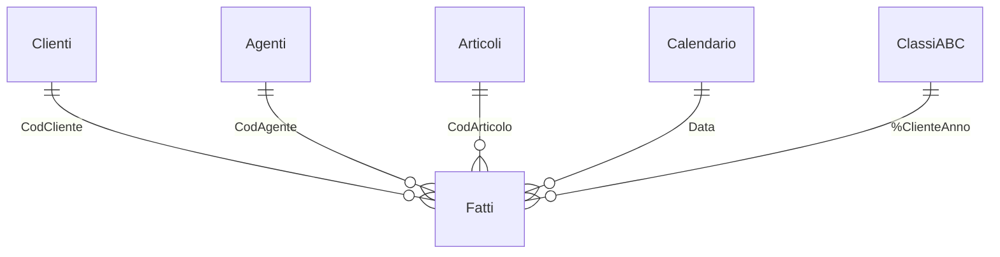

# Vendite, margini e livello di servizio – Qlik Sense

App Qlik Sense per l'analisi commerciale con architettura a due livelli. Un'app di estrazione salva i dati in QVD, un'app di analisi costruisce il modello e calcola fatturato, margini, budget, portafoglio ordini, puntualità delle consegne e classificazione ABC dei clienti.

> I dati sono **inventati** e generati con Python. Il progetto ricostruisce in forma generica tecniche usate in progetti reali: non contiene dati, nomi o codice di clienti.

## Architettura



Separare estrazione e analisi permette di interrogare il gestionale una volta sola e di riusare gli stessi QVD in più app.

## Modello dati

Una sola tabella dei fatti con il campo `Fonte` (`Fatturato`, `Ordinato`, `Budget`). È il modo tipico in Qlik per far convivere fonti con dimensioni in comune senza chiavi sintetiche né loop.



## Tecniche nello script

| Tecnica | Dove |
|---|---|
| SUB riutilizzabile con `STORE` in QVD e tabella di log | [01_Estrazione_QVD.qvs](script/01_Estrazione_QVD.qvs) |
| `MAPPING LOAD` + `ApplyMap` al posto delle join | tab *Mapping*, *Fatturato*, *Ordinato* |
| Concatenazione di fonti diverse in una tabella dei fatti | tab *Ordinato*, *Budget* |
| Preceding load (campo calcolato su un campo calcolato) | tab *Ordinato*: esito consegna da giorni di ritardo |
| Calendario master con `IterNo()` e flag `InYearToDate` | tab *Calendario* |
| Classe ABC per cliente e anno: `GROUP BY`, `LEFT JOIN`, `ORDER BY` + `Peek()`/`Previous()` | tab *ABC Clienti* |
| Variabili per la set analysis | tab *Variabili* |

## Espressioni

Le misure master sono in [espressioni/misure_master.md](espressioni/misure_master.md). Alcuni esempi di set analysis:

```
Fatturato YTD          Sum({<Fonte={'Fatturato'}, $(vSetYTD)>} Valore)
Clienti in calo > 20%  Count({<CodCliente={"=Sum({<Fonte={'Fatturato'}, $(vSetYTD)>} Valore) < 0.8 * Sum({<Fonte={'Fatturato'}, $(vSetLYTD)>} Valore)"}>} DISTINCT CodCliente)
Cross-selling          Count({<CodCliente = P({<Famiglia={'Caffè'}>} CodCliente) - P({<Famiglia={'Dolci e snack'}>} CodCliente)>} DISTINCT CodCliente)
```

I fogli previsti sono descritti in [espressioni/fogli.md](espressioni/fogli.md).

<!-- Aggiungi qui gli screenshot, ad esempio:  -->

## Come provarlo

1. In Qlik Sense crea due connessioni di tipo **Cartella**: `DatiPortfolio`, che punta alla cartella `data` di questo progetto, e `QVD`, che punta a una cartella vuota.
2. Crea un'app, incolla [01_Estrazione_QVD.qvs](script/01_Estrazione_QVD.qvs) nell'editor di script e ricarica.
3. Crea una seconda app, incolla [02_App_Vendite.qvs](script/02_App_Vendite.qvs) e ricarica.
4. Crea le misure master da [misure_master.md](espressioni/misure_master.md) e i fogli.

In Qlik Cloud le connessioni puntano a uno spazio dati (es. `lib://DataFiles/`). Basta cambiare le variabili `vSorgente` e `vQVD`.
