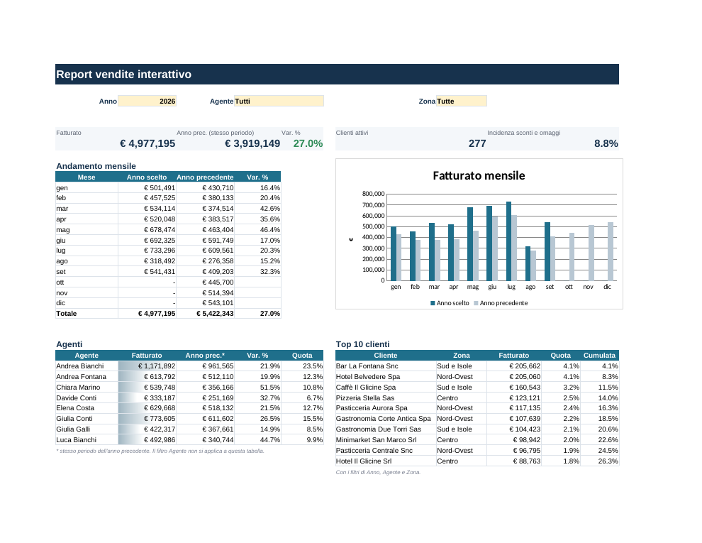

# Report vendite interattivo – Excel

Report in Excel con menu a tendina: scegli anno, agente e zona, e KPI, tabella mensile, grafico, tabella agenti e top 10 clienti si ricalcolano da soli. Senza macro e senza VBA, solo formule. Quando si incollano nuove righe nel foglio dati, il report le include automaticamente.

> I dati sono **inventati**: sono le stesse vendite del [progetto Power BI 01](../01-powerbi-vendite-crediti), aggregate per mese e cliente. I totali coincidono con quelli del report Power BI.

## Tecniche usate

| Tecnica | Dove | A cosa serve |
|---|---|---|
| `SOMMA.PIÙ.SE` con più criteri | KPI, tabella mensile, agenti, clienti | Somme filtrate per anno, mese, agente e zona |
| Criterio "Tutti" con il carattere jolly `*` | celle di servizio N3:N4 | La stessa formula vale con filtro attivo o disattivato |
| `MAX.PIÙ.SE` | cella N5 | Ultimo mese con dati, per confrontare l'anno precedente sullo **stesso periodo** |
| Intervalli denominati dinamici (`SCARTO` + `CONTA.VALORI`) | Gestione nomi (`dFatturato`, `dAnno`, …) | Le formule si estendono da sole alle righe aggiunte |
| `GRANDE` + `INDICE`/`CONFRONTA` | Top 10 clienti | Classifica con ricerca dei dati del cliente; i pari merito sono gestiti nel foglio Calcoli |
| Convalida dati a elenco | celle gialle | Menu a tendina per i filtri |
| Formattazione condizionale | variazioni %, barre dei dati | Colori su cali e crescite, barre sul fatturato degli agenti |
| Grafico collegato | Dashboard | Si aggiorna con i filtri |

Per le ricerche ho usato `INDICE`/`CONFRONTA` invece di `CERCA.X` così il file funziona su qualunque versione di Excel e anche in LibreOffice. In Excel 365 la stessa ricerca si scrive con `CERCA.X`.

## Fogli

| Foglio | Contenuto |
|---|---|
| Leggimi | Istruzioni e tecniche usate |
| Dashboard | Il report: filtri, KPI, andamento mensile, grafico, agenti, top 10 clienti |
| Dati | 5.887 righe: vendite per anno, mese e cliente (tabella `tblVendite`) |
| Calcoli | Fatturato di ogni cliente con i filtri attivi, usato per la classifica |
| Elenchi | Valori dei menu a tendina |

## Verifiche fatte

- Ricalcolo completo con LibreOffice: 781 formule, nessun errore.
- Con anno 2026 e nessun filtro: fatturato € 4.977.195, +27,0% sullo stesso periodo 2025, 277 clienti attivi. Sono gli stessi valori del report Power BI 01.
- Tre combinazioni di filtri (agente, zona, anno) confrontate con lo stesso calcolo fatto in Python: risultati identici.
